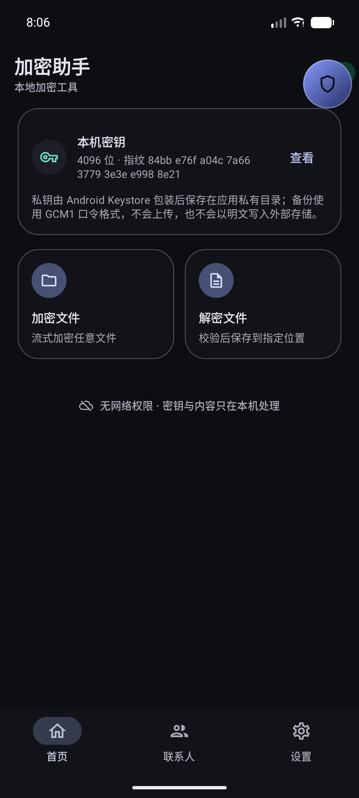
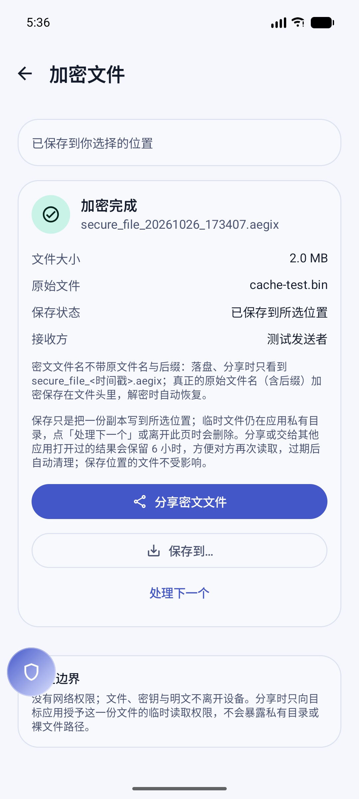

# 加密助手（Aegix）

本地离线运行的非对称加密工具：Android 应用（Kotlin + Jetpack Compose）与桌面端 Swing 程序，共用一份纯 Java 加密内核（`shared/crypto-core`）。

所有密钥都在本机生成，文件与文字加解密、签名、分卷默认全部离线完成；唯一可能的联网是默认关闭的「检查更新」，它只向 GitHub 的公开 Releases 接口请求一次版本号，不发送文件、密钥或账号信息。不含遥测，不上传任何内容。许可证 **GPL-3.0-only**，按开源、侧载方式分发，不上架应用商店。




## 下载

预编译 APK、Windows 便携 ZIP 与安装器通过本仓库的 Releases 分发；源码仓库不提交二进制。

## 功能

- **单文件加解密**：随机生成 256 位 AES 密钥，用接收方 RSA 公钥以 OAEP 包装；内容走 AES-256-GCM，`SHA256withRSA` 对明文签名。流式读写，不整体载入大文件。
- **多文件 / 文件夹**：先打包成一个 ZIP，再按 **50 MB / 100 MB / 500 MB / 1 GB / 2 GB** 切成可独立发送的加密分卷；每卷自带集合元数据，缺卷、重卷、混包会被拒绝。
- **超过单卷上限的单文件**：直接切成外部分卷（不经过 ZIP），合并后还原原文件；受 99 卷上限约束。
- **接收侧**：选齐全部分卷后逐卷合并，校验整包 SHA-256，再解密；Android 结果页可**安全解压**，拒绝 ZipSlip、超限条目与重复/冲突路径，重名自动 `_2` 且不覆盖已有文件。
- **密钥管理**：本地生成密钥对；私钥以口令加密保存（Android 用 Keystore 包装）；口令加密的备份导入/导出；联系人公钥；可选生物识别与应用锁。
- **系统文件入口**（Android）：注册单一文件入口，按文件名与文件头判型后进入加密或解密流程。
- **中英双语**（Android）：跟随系统语言，Android 13+ 可为应用单独指定语言。
- **隐写工具**（仅桌面端，实验性）：见下方“已知限制”。

## 平台差异

| 能力 | Android | 桌面端 |
|---|:--:|:--:|
| 单文件加解密 | 是 | 是 |
| 多文件打包与分卷 | 是 | 是 |
| 超限单文件直接分卷 | 是 | 是 |
| 分卷合并还原 | 是 | 是（单文件还原原文件，文件夹还原为 ZIP，自行解压） |
| 归档安全解压到目录 | 是 | 否 |
| 生物识别 / 应用锁 | 是 | 否（用口令） |
| 系统文件入口、悬浮球 | 是 | 否 |
| 隐写工具 | 否 | 是（实验性） |

两端共享同一份 `.aegix` / VOLU 容器实现。容器版本 1 自 1.4.0 起**冻结**：后续 1.x 必须能读 1.4.0 写出的文件，不兼容变更必须提升容器版本号。格式细节见 [`docs/加密文件格式规范.md`](docs/加密文件格式规范.md)。

## 安全模型

- **默认不联网**：Android 清单唯一的网络权限 `INTERNET` 只用于「设置 → 关于 → 检查更新」，默认关闭；关闭时不会在启动、打开文件或加解密时联网。
- **唯一请求**：只有你打开开关并点「检查更新」，应用才会向 GitHub 的公开 Releases 接口发一次匿名 GET，只读最新版本号；不发文件、密钥或账号信息，发现新版本也不下载、不安装。
- **离线完成**：密钥生成、加解密、签名与分卷全部在本机完成，不经过任何服务器。
- **签名对象是明文**：解密后先验签，签名不匹配时明确标记“发送者未识别”，不静默接受。
- **原文件名只存在于加密头**：外层密文文件名只含时间戳与卷号，日志、通知与分享意图都不写原文件名。
- **本地数据**：桌面端数据目录默认在程序目录旁，可用设置改到其他位置；运行期数据不随源码分发。

完整威胁模型见 [THREAT-MODEL.md](THREAT-MODEL.md)，漏洞披露见 [SECURITY.md](SECURITY.md)。本工具不防 root 或已被恶意软件控制的环境；Windows 安装器/便携包未做 Authenticode 代码签名，APK 使用项目本地证书签名，请从官方 Release 下载并核对 SHA-256。

## 从源码构建

需要 **JDK 17**。Android 另需 Android SDK（compileSdk 36）；桌面端另需 Maven 3。

### Android

```bash
cd android
./gradlew :app:assembleDebug                      # 产物：app/build/outputs/apk/debug/app-debug.apk
./gradlew :app:testDebugUnitTest :crypto-core:test  # JVM 单测
```

Release 签名读取 `android/keystore.properties`（不入库）；缺少该文件时 release 产物不签名，其余构建不受影响。设备测试需要模拟器或真机：`./gradlew :app:connectedDebugAndroidTest`。

### 桌面端（Swing）

桌面端以固定版本 artifact 引用共享内核，构建前先发布到本机 Maven 仓库：

```bash
cd android && ./gradlew :crypto-core:publishToMavenLocal
cd ../desktop && mvn -B clean package -DskipTests
java -jar target/asymmetric-encryption-tool-1.4.1-jar-with-dependencies.jar
```

Windows 上可打包自带运行时的便携 ZIP（需要带 `jlink` / `jpackage` 的 JDK 17）：

```bat
cd desktop
package-portable.bat
:: 产物：desktop\target\portable\CryptoAssistant-1.4.1-win64.zip
```

生成 Windows EXE 安装器（需管理员安装；构建机需 WiX Toolset 3，脚本会自动探测 `%LOCALAPPDATA%\CryptoAssistant\build-tools\wix3` 或 Program Files）：

```bat
cd desktop
package-installer.bat
:: 产物：desktop\target\installer\CryptoAssistant-1.4.1.exe
```

## 已知限制

- Android 的真机验收矩阵尚未完成：厂商 ROM、微信 / QQ 等三方入口、部分第三方文档提供方未覆盖。模拟器通过不等于真机通过。
- 单卷 500 MB 以上、以及 Android→Android 之间的多卷互操作尚未验证。
- 桌面端隐写工具为实验性功能：RS(255,171) 只做编码与错误检测，不做纠错。
- **不提供旧格式兼容**：只识别 `.aegix`，旧 `.enc` 后缀不再识别。容器版本 1 已冻结；其他版本明确拒绝，不回退。
- 安装器是 per-machine 安装，需要管理员权限；程序文件在 `Program Files`，数据回退到 `%APPDATA%\CryptoAssistant\data`，卸载不会删除该目录。
- 本仓库只提供源码，不含预编译 APK 或安装包。

## 目录结构

| 路径 | 内容 |
|---|---|
| `android/` | Android 应用（Kotlin + Compose）与桌面桥接模块 |
| `shared/crypto-core/` | 两端共享的纯 Java 加密内核（Java 8 字节码） |
| `desktop/` | 桌面端 Swing 程序（Maven，JDK 17 构建） |
| `docs/` | 加密文件格式规范与截图 |

## 文档

- [加密文件格式规范](docs/加密文件格式规范.md)：`.aegix` 单文件容器与外部分卷容器的字节布局与语义。

## 许可证

GPL-3.0-only，见 [LICENSE](LICENSE)。本软件按“原样”提供，不附带任何担保；请自行评估是否满足你的安全需求。
